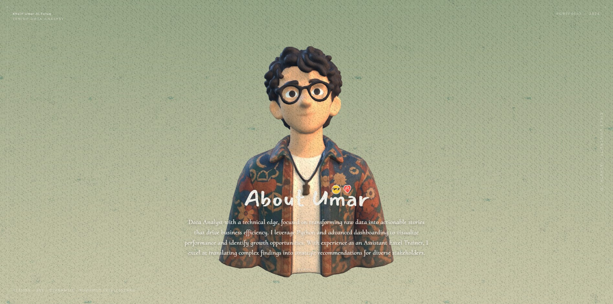

<h1 align="center">About Umar · 3D Personal Portfolio</h1>

<p align="center">
  <a href="LICENSE"></a>
  <a href="https://github.com/khalifumar/portfolio-umar"></a>
  
  
  
  
  
  
</p>

<p align="center"><b>Interactive 3D Portfolio of Khalif Umar Al Faruq — Junior Data Analyst specializing in Python, SQL, Streamlit, and Business Intelligence.</b></p>

<p align="center">
  <a href="#quick-start">Quick Start</a> |
  <a href="#key-features">Key Features</a> |
  <a href="#project-structure">Project Structure</a> |
  <a href="#customization">Customization</a> |
  <a href="#deploy">Deploy</a> |
  <a href="README.zh.md">简体中文</a>
</p>

<p align="center">
  <a href="https://github.com/khalifumar/portfolio-umar"></a>
</p>

An interactive, scroll-driven 3D personal portfolio and résumé for **Khalif Umar Al Faruq (Umar)**, built with **React Three Fiber + TypeScript + Three.js + Vite**. Features a fixed 3D background with smooth camera movements synchronized with page scrolling, coupled with interactive HTML overlays showcasing professional experience (Bina Nusantara University, Digipack.id, MySkill Academy, Google Student Ambassador, PT Adhi Karya) and data science & business analytics projects.

The camera animation path is baked into the `.glb` 3D model, layered with real-time auto-focus depth-of-field, cursor-tracking eye movements, Bloom, and cinematic film grain. A pure front-end Single Page Application (SPA) where `npm run build` outputs a completely static `dist/` ready to host anywhere.

> **Open-Source & Usage Terms**  
> - The **code** is licensed under **MIT** (see [`LICENSE`](LICENSE)).  
> - The **personal content, data, and 3D assets** (name, character model, personal résumé, project write-ups, brand logos, and credentials) belong to **Khalif Umar Al Faruq** and are **not covered by MIT** — please replace them with your own details after forking (see [`NOTICE`](NOTICE)).

---

## Quick Start

The front-end application lives inside [`web/`](web). All code and asset paths are relative to `web/`, and npm commands must be run inside `web/`.

### 1. Clone & Install

```bash
git clone https://github.com/khalifumar/portfolio-umar.git
cd portfolio-umar/web
npm install
```

### 2. Run Local Development

```bash
npm run dev        # Local dev server at http://localhost:5173
```

### 3. Other Build Commands

```bash
npm run build      # Type check + production bundle (outputs to web/dist/)
npm run preview    # Preview the built production output
npm run typecheck  # TypeScript check only (tsc -b)
npm run lint       # ESLint check
```

**Requirements:** Node.js 20+. No backend database, server setup, or API keys required.

---

## Key Features

- 🎬 **Scroll-Driven Camera Movements:** The 3D camera glides between focal points corresponding to each résumé milestone and project gallery stop as you scroll.
- 👁️ **Interactive Eye Tracking:** The 3D avatar's eyes dynamically follow the visitor's cursor across the screen.
- 📊 **Data Analyst Project Gallery:** Modular markdown-driven portfolio showcasing real-world projects:
  - **Business Analytics & Reporting Suite** (SQL · Data Modeling · PostgreSQL · KPI Tracking)
  - **5-Min Price Ready Sales Engine** (Python · Streamlit · Local LLM · RapidFuzz)
  - **American Store Sales Analysis** (Excel · Power Query · 9,900+ Records EDA)
  - **Rental Bikes Analysis** (Python · Streamlit · Pandas · Time-Series EDA)
  - **The Sumatra Poverty Paradox** (Looker Studio · SQL · Policy Analytics)
- 🎓 **Career & Education Timeline:** Highlights academic excellence at Bina Nusantara University (Computer Science, GPA 3.71, 100% Scholarship) and professional roles at Digipack.id, MySkill Academy, Google Student Ambassador, and PT Adhi Karya.
- 🏆 **National Honors & Accreditations:** Samsung Solve for Tomorrow 2025 Semifinalist, Youth Microfound Business Plan Competition Best Execution, and certified specializations.
- 🎨 **Cinematic Visual Effects:** Post-processing pipeline with Depth of Field, Bloom, SMAA antialiasing, and film grain overlay.
- 🌐 **Fully Static & Portable:** Zero backend, relative asset pathing (`base: './'`), ready for GitHub Pages, Cloudflare Pages, Netlify, or Vercel.

---

## Project Structure

```
portfolio-umar/
├── web/                               # Front-end React Three Fiber application
│   ├── index.html                     # HTML entry point (SEO metadata & Google Fonts)
│   ├── package.json                   # Dependencies and npm scripts
│   ├── vite.config.ts                 # Vite config (relative base './')
│   ├── src/
│   │   ├── main.tsx                   # React root entry
│   │   ├── App.tsx                    # Canvas assembly, Hero (About Umar), scroll layout
│   │   ├── store.ts                   # Zustand global interaction state
│   │   ├── styles.css                 # Global styling, responsive layout, dark aesthetic
│   │   ├── data/
│   │   │   ├── works.ts               # Works sections: Analytics, Skills, Training, Honors
│   │   │   ├── workDocs.ts            # Markdown loader and frontmatter parser for projects
│   │   │   └── focusPoints.ts         # 6 camera timeline anchors (focus-1 to focus-6)
│   │   ├── content/works/             # Individual project markdown write-ups
│   │   │   ├── american-store-sales.md
│   │   │   ├── business-analytics-suite.md
│   │   │   ├── price-ready-sales-engine.md
│   │   │   ├── rental-bikes-analysis.md
│   │   │   ├── sumatra-poverty-paradox.md
│   │   │   └── example.md
│   │   ├── scene/
│   │   │   ├── Scene.tsx              # 3D Scene, avatar loader, camera track, eye tracker
│   │   │   └── Env.tsx                # HDR lighting & environment reflections
│   │   └── ui/
│   │       ├── Resume.tsx             # Interactive résumé milestones & credentials
│   │       ├── Works.tsx              # Horizontal project gallery & detail modals
│   │       ├── LoadingScreen.tsx      # Model loading animation
│   │       ├── NoiseOverlay.tsx       # Cinematic film grain overlay
│   │       ├── SocialIcons.tsx        # LinkedIn, GitHub, Email icons
│   │       └── ZooopLogo.tsx          # SVG brand logo
│   └── public/
│       ├── models/                    # 3D assets (me.glb, me_original.glb)
│       ├── works/covers/              # Project section cover imagery
│       ├── textures/                  # env.hdr environment map
│       ├── images/                    # UI icons and graphics
│       └── fonts/                     # Typography assets
├── blender/                           # Blender 3D source files (sen.blend)
├── tutor/                             # Step-by-step guides (deploy, stickers, intro3d, eyes)
├── docs/                              # Documentation previews (preview.jpg)
├── .github/workflows/deploy.yml       # GitHub Actions CI/CD for GitHub Pages
├── README.md                          # Primary documentation (English)
├── README.zh.md                       # Chinese documentation (简体中文)
├── CLAUDE.md / AGENTS.md              # Conventions for AI coding assistants
└── LICENSE / NOTICE                   # Open source license & personal content notice
```

---

## Customization

Content is cleanly decoupled from 3D presentation:

| What to Update | File Path | Description |
| --- | --- | --- |
| **Hero & About Copy** | [`web/src/App.tsx`](web/src/App.tsx) | Edit the `COPY` object (`title` and `paragraphs`) |
| **Résumé & Timeline** | [`web/src/ui/Resume.tsx`](web/src/ui/Resume.tsx) | Education, work experience, roles, scholarship, certifications |
| **Social Links** | [`web/src/ui/Resume.tsx`](web/src/ui/Resume.tsx) | `SOCIAL_LINKS` array (LinkedIn, GitHub, Email) |
| **Project Catalog** | [`web/src/data/works.ts`](web/src/data/works.ts) | Project sections, live app links, tags, and descriptions |
| **Project Write-Ups** | [`web/src/content/works/*.md`](web/src/content/works) | Markdown files with frontmatter linked by project `slug` |
| **Camera Focus Anchors** | [`web/src/data/focusPoints.ts`](web/src/data/focusPoints.ts) | `FOCUS_POINTS` array (keep in sync with `Resume.tsx` entries) |
| **Scene Lighting & Post-FX**| [`web/src/scene/Scene.tsx`](web/src/scene/Scene.tsx) | Constants for lights, Depth of Field, Bloom, and model position |
| **3D Model** | [`web/public/models/me.glb`](web/public/models/me.glb) | Export from Blender or [intro3d.com](https://intro3d.com) |

---

## How It Works

This is a pure front-end Single Page Application (SPA):  
`index.html` → `src/main.tsx` → `src/App.tsx` (Fixed 3D `<Canvas>` background + scrollable HTML content overlay).

### 1. Camera Timeline Sync
The camera movement syncs with the résumé milestones through `CameraAction`'s frame convention (24 fps):

```
Frame 0                                                              Last Frame
   │         │         │         │         │         │         │         │
focus-0   focus-1   focus-2   focus-3   focus-4   focus-5   focus-6   focus-works
 Hero     ├─ 50 fr ─┤ 50 frames per résumé milestone             Tail = Works Gallery
```

```ts
// web/src/data/focusPoints.ts
export const FOCUS_POINTS = ['focus-1', 'focus-2', 'focus-3', 'focus-4', 'focus-5', 'focus-6'] as const
export const FRAMES_PER_NODE = 50
```

### 2. 3D Model Requirements
The `.glb` file located at `web/public/models/me.glb` contains specific named objects that the engine queries:
- **Camera + `CameraAction`**: The baked camera animation track.
- **`focus-0` (or `focus-start`)**: Starting hero focus anchor.
- **`focus-1` through `focus-6`**: Focal points for each résumé entry.
- **`focus-works`**: Focal point for the project gallery.
- **Mesh containing `eye`**: Targets for the cursor-following eye motion.

---

## Deploy

```bash
cd web
npm run build    # Generates production bundle in web/dist/
```

Because `base: './'` is configured in `vite.config.ts`, all assets use relative paths. The `dist/` directory can be deployed directly to:
- **GitHub Pages:** Included via [`.github/workflows/deploy.yml`](.github/workflows/deploy.yml) on push to `main`.
- **Vercel / Cloudflare Pages / Netlify:** Set build command to `npm run build` and output directory to `web/dist`.

---

## Tech Stack

- **Core:** React 18 · TypeScript 5 · Vite 5
- **3D & Graphics:** Three.js (r169) · @react-three/fiber · @react-three/drei · @react-three/postprocessing
- **Animation & State:** Framer Motion · Zustand
- **Analytics & Tools:** Python · SQL · Streamlit · PostgreSQL · Microsoft Excel Power Query · Looker Studio

---

## License & Copyright

- **Code:** Licensed under [MIT](LICENSE).
- **Personal Content & 3D Model:** © Khalif Umar Al Faruq (Umar). All rights reserved. **Not covered by MIT** — see [`NOTICE`](NOTICE). Please substitute your own avatar model, personal resume, project texts, and brand logos.
